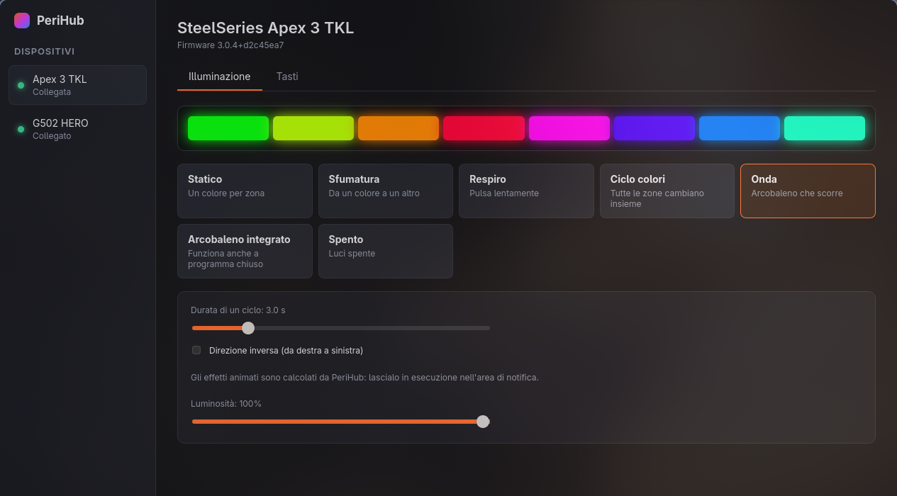
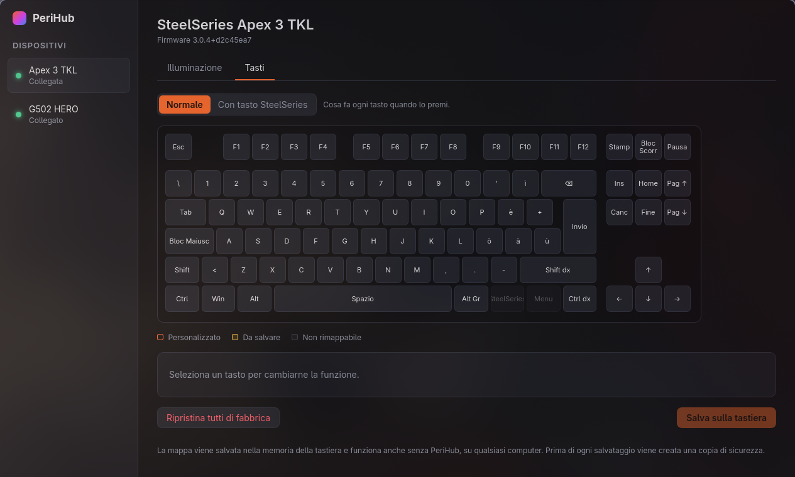
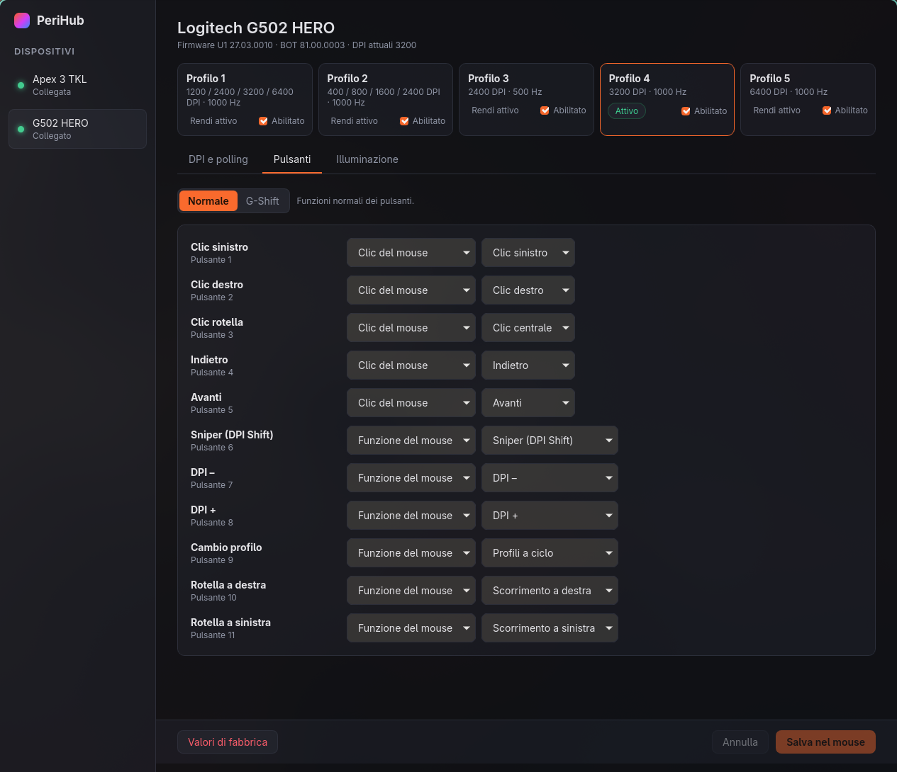
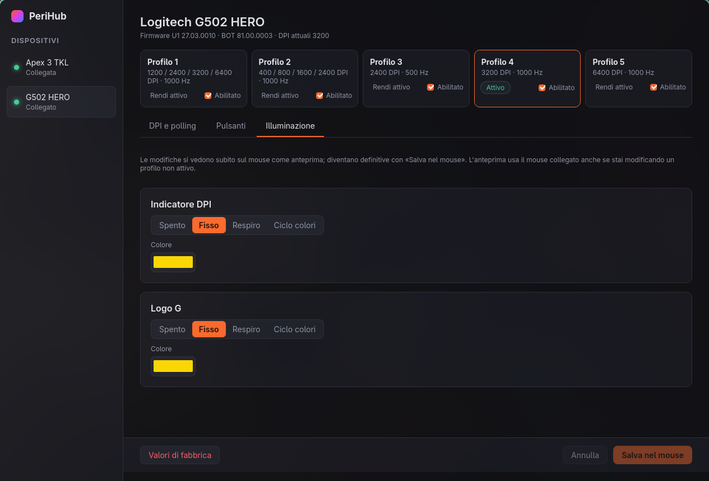

<p align="center">
  
</p>

<h1 align="center">PeriHub</h1>

<p align="center">
  Configura la <b>SteelSeries Apex 3 TKL</b> e il <b>Logitech G502 HERO</b> su Windows e Linux,<br>
  senza SteelSeries GG né Logitech G HUB.
</p>

<p align="center">
  <a href="https://github.com/hex-dump/perihub/releases/latest"></a>
  <a href="https://github.com/hex-dump/perihub/actions/workflows/ci.yml"></a>
  <a href="LICENSE"></a>
</p>

> *English: open-source replacement for SteelSeries GG and Logitech G HUB for the Apex 3 TKL keyboard and the G502 HERO mouse, written in Rust + Tauri, for Windows and Linux. The UI is in Italian.*



## Indice

- [Funzionalità](#funzionalità)
- [Download e installazione](#download-e-installazione)
- [Come si usa](#come-si-usa)
- [Sicurezza](#sicurezza)
- [Domande frequenti](#domande-frequenti)
- [Limiti noti e prossimi passi](#limiti-noti-e-prossimi-passi)
- [Compilare dai sorgenti](#compilare-dai-sorgenti)
- [Come è fatto](#come-è-fatto)
- [Riconoscimenti e licenza](#riconoscimenti-e-licenza)

## Funzionalità

### SteelSeries Apex 3 TKL

| Funzione | Dettagli | Dove viene salvata |
|---|---|---|
| Illuminazione a 8 zone | Statico (un colore per zona), sfumatura, respiro, ciclo colori, onda, arcobaleno integrato, spento | PC: PeriHub la riapplica a ogni collegamento |
| Luminosità | 0–100% in 17 passi, sincronizzata con SteelSeries + F11/F12 | PC |
| Rimappatura tasti | Ogni tasto, sul livello normale e sul livello «tasto SteelSeries premuto» | **Memoria della tastiera**: funziona anche senza PeriHub |

### Logitech G502 HERO

| Funzione | Dettagli | Dove viene salvata |
|---|---|---|
| Profili | 5 profili: attivazione, abilitazione, ripristino di fabbrica | **Memoria del mouse** |
| DPI | Fino a 5 livelli da 100 a 25600 (passo 50), livello predefinito e sniper, prova dal vivo | Memoria del mouse |
| Polling | 125, 250, 500, 1000 Hz | Memoria del mouse |
| Pulsanti | 11 pulsanti più il livello G-Shift: clic, tasti con Ctrl/Shift/Alt/Win/Alt Gr, tasti multimediali, DPI su/giù/ciclo/sniper, cambio profilo | Memoria del mouse |
| Illuminazione | Logo e indicatore DPI: spento, fisso, respiro, ciclo colori, con anteprima dal vivo | Memoria del mouse |

<table>
  <tr>
    <td></td>
    <td></td>
  </tr>
  <tr>
    <td></td>
    <td></td>
  </tr>
</table>

## Download e installazione

Scarica il file per il tuo sistema dalla [pagina delle release](https://github.com/hex-dump/perihub/releases/latest).

### Windows

1. Scarica `PeriHub_…_x64-setup.exe` (oppure il `.msi`) e avvialo.
2. L'installer non è firmato digitalmente: se Windows SmartScreen lo blocca, clicca **Ulteriori informazioni → Esegui comunque**.
3. **Chiudi SteelSeries GG e Logitech G HUB** e disattivane l'avvio automatico. Due programmi che parlano con lo stesso dispositivo si ostacolano.

Non servono driver: PeriHub usa le interfacce HID standard di Windows.

### Linux

**AppImage** (qualsiasi distribuzione, anche Arch e CachyOS):

```sh
chmod +x PeriHub_*_amd64.AppImage
./PeriHub_*_amd64.AppImage
```

**Debian/Ubuntu** (`.deb`) e **Fedora/openSUSE** (`.rpm`): installa il pacchetto con il gestore della tua distribuzione.

#### Permessi USB

I pacchetti `.deb` e `.rpm` installano da soli una regola udev. Con l'AppImage, se PeriHub mostra «permesso negato», installala a mano:

```sh
sudo curl -o /etc/udev/rules.d/70-perihub.rules \
  https://raw.githubusercontent.com/hex-dump/perihub/main/packaging/linux/70-perihub.rules
sudo udevadm control --reload && sudo udevadm trigger
```

La regola dà accesso alle sole interfacce HID di questi due dispositivi, e solo all'utente con la sessione attiva. Se hai già OpenRGB con le sue regole udev, probabilmente non serve.

## Come si usa

- **Tastiera → Illuminazione**: scegli un effetto. Le modifiche si applicano subito e vengono ricordate.
- **Tastiera → Tasti**: clicca un tasto, scegli la nuova funzione e premi **Salva sulla tastiera**. Con «Con tasto SteelSeries» modifichi cosa fa ogni tasto mentre tieni premuto il tasto SteelSeries.
- **Mouse**: scegli il profilo in alto e modifica DPI, pulsanti e luci. Le modifiche vanno nel mouse solo quando premi **Salva nel mouse**. Prima del salvataggio i DPI e i LED si possono provare dal vivo; uscendo dalla pagina, il mouse torna alle impostazioni salvate.
- **G-Shift**: assegna «G-Shift» a un pulsante. Mentre lo tieni premuto, gli altri pulsanti usano le funzioni della scheda G-Shift.

### PeriHub in background

Chiudere la finestra **non** chiude PeriHub. Resta attivo per animare le luci della tastiera e per riapplicarle quando la ricolleghi o il PC si risveglia. Per riaprirlo usa l'icona nell'area di notifica oppure avvialo di nuovo. Per chiuderlo davvero: **Impostazioni → Esci da PeriHub**.

L'**avvio automatico** si attiva in Impostazioni. Su Hyprland le voci di avvio automatico XDG funzionano solo se è attivo `xdg-desktop-autostart.target` (con uwsm o systemd). In alternativa aggiungi alla configurazione:

```
exec-once = /percorso/di/perihub --hidden
```

Per vedere l'icona nell'area di notifica su Hyprland/Sway serve una barra con il modulo tray (es. Waybar).

## Sicurezza

PeriHub non modifica il firmware. Usa gli stessi comandi di configurazione dei programmi ufficiali, con alcune protezioni in più:

- **Comandi limitati**: il codice può inviare solo i comandi verificati.
  - Il comando che porta la Apex nel bootloader non è rappresentabile.
  - Sul G502 si usano solo le funzioni HID++ `0x0000`, `0x0001`, `0x0003`, `0x0005`, `0x2201`, `0x8060`, `0x8070`, `0x8100`.
- **Scritture verificate**:
  - Mouse: i profili si modificano sopra i byte originali del settore, così i campi non gestiti restano intatti. Dopo ogni scrittura il settore viene riletto e confrontato byte per byte.
  - Tastiera: la mappa dei tasti si scrive prima in RAM e viene salvata solo se la rilettura corrisponde, altrimenti viene ripristinata.
- **Profili di fabbrica intoccabili**: i settori ROM del mouse sono di sola lettura e servono per il ripristino.
- **Copie di sicurezza**: prima di ogni scrittura nella memoria di un dispositivo, PeriHub salva lo stato precedente in
  - Linux: `~/.config/perihub/backups/`
  - Windows: `%APPDATA%\perihub\backups\`

## Domande frequenti

**Posso tenere aperti anche GG o G HUB?**
No: chiudili. Su Windows G HUB, in particolare, controlla il mouse e annullerebbe le modifiche.

**Perdo la garanzia?**
PeriHub non tocca il firmware. Scrive solo le impostazioni (profili, mappa dei tasti) che scrivono anche i programmi ufficiali.

**Perché la tastiera torna all'arcobaleno quando PeriHub è chiuso?**
La Apex 3 TKL non memorizza i colori: anche con GG funziona così. PeriHub li riapplica appena la rileva. L'effetto «Arcobaleno integrato» è l'unico generato dalla tastiera stessa.

**Come torno alle impostazioni di fabbrica?**
Tastiera: **Tasti → Ripristina tutti di fabbrica**. Mouse: **Valori di fabbrica** su ogni profilo. In più ci sono le copie di sicurezza.

**Funziona con altri modelli?**
Per ora solo Apex 3 TKL (`1038:1622`, firmware 3.0.4) e G502 HERO (`046d:c08b`). Altri modelli con lo stesso protocollo sono facili da aggiungere: apri una issue con il modello e l'ID USB.

## Limiti noti e prossimi passi

- **Windows**: compilato e impacchettato dalla CI, ma non ancora provato su un PC Windows reale. Segnalazioni benvenute.
- **Etichette da confermare**: il significato delle funzioni di fabbrica SteelSeries + F9/F10 e il tasto in basso a destra (Menu o Win).
- **Prossimi passi**:
  - cambio profilo automatico in base al gioco o programma attivo;
  - macro software;
  - illuminazione reattiva ai tasti;
  - compatibilità con GameSense.
- **Non previsti**: Sonar e Moments di SteelSeries GG, gli script Lua di G HUB.

## Compilare dai sorgenti

Servono [Rust](https://rustup.rs) stabile (≥ 1.88) e [Node.js](https://nodejs.org) ≥ 20.19. Su Linux servono anche le librerie di sviluppo di WebKitGTK 4.1, libayatana-appindicator, librsvg e libudev:

```sh
# Debian/Ubuntu
sudo apt install libwebkit2gtk-4.1-dev libayatana-appindicator3-dev librsvg2-dev libudev-dev
# Arch/CachyOS
sudo pacman -S webkit2gtk-4.1 libayatana-appindicator librsvg
```

```sh
git clone https://github.com/hex-dump/perihub.git
cd perihub/app
npm install
npm run tauri dev                     # sviluppo, con ricarica automatica
npm run tauri build -- --no-bundle    # eseguibile in target/release/perihub
npm run tauri build                   # pacchetti per il sistema corrente
```

Non usare `cargo build` da solo per l'app: l'eseguibile che produce cerca l'interfaccia sul server di sviluppo (`localhost:1420`).

Test e controlli:

```sh
cargo test --workspace          # include test sui settori letti da un G502 HERO reale
cargo clippy --workspace --all-targets
cd app && npm run check         # controllo dei tipi dell'interfaccia
```

### Strumento a riga di comando

Utile per diagnostica e script. Non usarlo mentre l'app è aperta: si contenderebbero gli stessi dispositivi.

```sh
cargo run -p perihub-cli -- status
cargo run -p perihub-cli -- mouse state
cargo run -p perihub-cli -- keyboard keymap
cargo run -p perihub-cli -- keyboard light '{"type":"wave","period_ms":3000,"reverse":false}' 10
```

## Come è fatto

```
crates/perihub-core     libreria Rust: protocolli, effetti, rilevamento, configurazione
  src/apex/             SteelSeries Apex 3 TKL: RGB (report di output) e mappa tasti (feature report)
  src/hidpp/            Logitech HID++ 2.0 e formato dei profili in memoria (con CRC-CCITT)
  src/effects.rs        effetti di luce calcolati dal PC
  src/manager.rs        collegamento/scollegamento dei dispositivi
  src/worker.rs         un thread per dispositivo: niente richieste accavallate
  tests/fixtures/       settori reali del G502 HERO usati dai test
crates/perihub-cli      strumento a riga di comando
app/                    interfaccia: Tauri 2 + Svelte 5
packaging/linux         regola udev
```

- La comunicazione passa da [hidapi](https://github.com/libusb/hidapi). Su Linux il backend è hidraw, quindi tastiera e mouse continuano a funzionare normalmente mentre PeriHub è aperto.
- Su Windows le collezioni HID++ corta e lunga del mouse sono dispositivi separati: PeriHub usa quella lunga (report `0x11`).

## Riconoscimenti e licenza

I protocolli sono stati ricostruiti grazie al lavoro di:

- [OpenRGB](https://gitlab.com/CalcProgrammer1/OpenRGB): documentazione del protocollo di illuminazione Apex a 8 zone. Il codice non è stato copiato.
- [libratbag](https://github.com/libratbag/libratbag): Logitech HID++ 2.0 e profili in memoria (MIT).
- [gorkemgun/apex-3-tkl](https://github.com/gorkemgun/apex-3-tkl): mappa dei tasti della Apex 3 TKL (MIT).

PeriHub è distribuito con [licenza MIT](LICENSE). Non è affiliato a SteelSeries né a Logitech; i nomi dei prodotti appartengono ai rispettivi proprietari.
